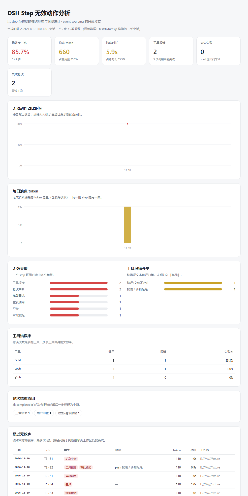
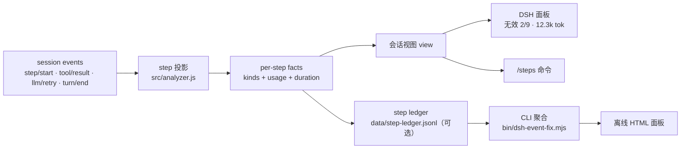

# dsh-event-fix

> **DSH 会话日志的 step 级错误统计与浪费核算。**
>
> 它不改请求、不改工具、不调模型；只读取事件流，回答「哪些 step 白干了、白花了多少 token 和时间」。

`dsh-event-fix` 是 DeepSeek Harness（DSH）的一个只读分析插件。定位很窄：**event sourcing 里的一个小分支**——
只解释那些语义明确的会话事件（工具报错、模型重试、轮次中断、重复调用、空转步），
不做意图判断，也不假装能评价「这次回答好不好」。



## 三个问题

### 1. 一个会话里，哪些 step 是无效动作？

以 step 为粒度归因，每一条无效步都能对上原始事件：

| 无效类型 | 判定依据（事件） | 说明 |
|---|---|---|
| 工具报错 | `tool/result` 的 `isError = true`，**message 级与 part 级都算** | 最硬的一类，按错误文本再分类 |
| 命令失败 | shell 结果出现 `[exit code: 非0]`，或 `command/done.kind = error` | DSH 不把命令失败当 `isError`，必须读退出码 |
| 模型重试 | 同一步内出现 `llm/retry` | 说明该步的首次请求失败，token 白付 |
| 轮次中断 | `turn/end.reason.kind ≠ completed` | 归因到该轮最后一步 |
| 重复调用 | 与本会话早前 `name + arguments` 完全一致 | 若两次调用之间有成功写入，则不算重复 |
| 空转步 | 一步既无文本也无工具调用 | 只有 reasoning 也算空转 |
| 审批被拒 | `approval/decided.outcome ∈ rejected/cancelled` | 用户明确拒绝的动作 |

工具结果在日志里有两种结构，**都要读**，否则会漏掉一大半失败：

```text
扁平  { message: { role: 'tool', isError: true, content: [{ type: 'text', text }] } }          # 只用来表示失败
嵌套  { message: { role: 'user', content: [{ type: 'tool-result', isError, toolCallId,
               content: [{ type: 'text', text }] }] } }                                        # 成功与失败都用它
```

嵌套结构的 `source` 只带 `callId` 不带工具名，工具名要用早前的 `tool/call` 回填。

### 2. 一共浪费了多少 token 和时间？

- **浪费 token** = 上述无效步实际发生的 `usage` 之和（input / output / cache read / cache write）。
  这是「无效动作附带的算力」，不是账单；缓存读取单价低，所以 token 占比通常高于费用占比。
- **浪费时长** = 无效步 `step/end - step/start` 的墙钟时间之和，模型重试的退避时间包含在内。
- 两个指标都同时给出绝对值与占比，避免只看占比产生错觉。

### 3. 无效动作的占比随时间怎么变？

- 会话内：面板里的「每轮无效占比」折线，一眼看到哪一轮开始跑偏。
- 跨会话：`scan --html` 生成的离线面板按自然日聚合，给出占比时序 + 每日浪费 token。

## 真实数据样例

本机 215 个 DSH 会话、8715 个 step 的实测结果（2026-11-17，v0.1.2 口径）：

```text
无效步 1403（16.1%） · 浪费 token 128.90M（12.2%） · 浪费时长 27h09m（18.6%）
工具调用 13554，显式报错 951 · 命令退出码非 0 511（涉及 469 步）· 模型重试 146 · 失败轮次 81

无效类型：工具报错 725 / 命令失败 469 / 重复调用 169 / 轮次中断 80 / 模型重试 63 / 空步 53 / 审批被拒 3
报错分类：网络 430 / 退出码非 0 333 / 跨域重定向 135 / 其他 107 / 超时 81 / 权限 78 / 调用方式 54 / 路径 54
Top 工具：web_fetch 625/3713（16.8%）· pwsh 571/3776（15.1%）· subagent 53/152（34.9%）· edit 70/1167（6%）
```

几点值得注意的结论：

- **`subagent` 的失败率 34.9%**，是所有工具里最高的，是最值得优先修的一类。
- **`web_fetch` 16.8%、`pwsh` 15.1%**：两个高频工具都在「六分之一的调用是白跑」的量级。
- **命令失败 469 步**：这些在旧口径里完全不可见——DSH 不把 shell 非零退出当 `isError`，
  只看 `isError` 会让 pwsh 的失败率从 15.1% 掉到 1.5%。
- **时长浪费比例（18.6%）高于 token 比例（12.2%）**：无效步主要烧在工具等待上，不烧 token 但烧时间。

## 三种用法

### 1. CLI：一次性扫描全部会话

```powershell
# 摘要（默认读 $DSH_HOME/sessions）
node bin/dsh-event-fix.mjs scan

# 最近 7 天 + 生成离线面板
node bin/dsh-event-fix.mjs scan --since 7d --html .\reports\report.html

# 导出机器可读结果
node bin/dsh-event-fix.mjs scan --json .\reports\report.json --quiet
```

参数：`--root <dir>`、`--since 7d|24h|2026-11-01`、`--session <id>`、`--limit <n>`、`--html`、`--json`。

### 2. DSH 面板：会话内实时看

安装后在输入框下方出现一个胶囊：`无效 2/9 · 12.3k tok`。
点开是当前会话的分项面板：KPI、每轮无效占比折线、无效类型、报错分类、最近无效步。

### 3. 命令：`/steps`

```text
/steps        文本摘要（与 CLI 同口径）
/steps json   当前会话的完整视图 JSON
```

## 架构



这条分支只依赖事件，不依赖 DSH 内部状态：同一份会话日志用 CLI 重放，得到的数字必须和面板一致
（测试里对此有断言）。

## 安装

### 先确认 `dsh` 能跑

DSH 是自带 Node 运行时的绿色发行版，**CLI 没有被装进全局**，所以直接敲 `dsh` 会报
`The term 'dsh' is not recognized`。三条路，任选一条：

**A. 一次性的完整调用**（不改环境，立刻可用）：

```powershell
& "E:\program\DeepSeek\runtime\node-v24.19.0-win-x64\node.exe" `
  "E:\program\DeepSeek\app\node_modules\@deepseek-ai\dsh\lib\bin.js" `
  plugin --profile web add link:E:/programs/dsh-event-fix
```

注意：必须用发行版自带的 `node.exe`，并且 `DSH_HOME` 指向 `<发行版>\.dsh`，否则会读到空 profile。

**B. 放一个 shim 到已在 PATH 的目录**（推荐，之后 `dsh` 就一直能用）：

```powershell
Copy-Item E:\programs\dsh-event-fix\install\dsh.cmd "$env:USERPROFILE\.local\bin\dsh.cmd"
```

`install/dsh.cmd` 会设好 `DSH_HOME`、把便携 Node 加到 PATH 前面，并在启动 app 时清掉
代理变量（代理残留会让模型请求变成 `Connection error`），但保留代理供 `pnpm` 装包。

**C. 跑 CLI 命令用绝对路径**，不装插件，只出离线面板（见上文「CLI」）。

### 本地开发链接（推荐）

```powershell
dsh plugin --profile web add link:E:/programs/dsh-event-fix
```

装完 `dsh plugin --profile web list --depth 0` 应能看到 `dsh-event-fix@link:...`。

然后确认 profile 的 `package.json` 包含依赖与 bundle：

```json
{
  "dependencies": { "dsh-event-fix": "link:E:/programs/dsh-event-fix" },
  "dsh": { "profile": { "bundles": ["dsh-event-fix"] } }
}
```

重启 DSH web 进程；日志出现 `[event-fix] active` 即生效。之后发一轮请求，输入框下方会出现胶囊。

**不想重启也能先验证**：`dsh web --help` 会把插件树完整挂载一遍再打印帮助，日志里出现
`[event-fix] active; projection=step-errors; ledger=...` 就说明宿主侧加载成功（客户端胶囊仍需重启才出现）。

重启方式（DSH 那个控制台窗口里 Ctrl+C 也行）：

```powershell
# 1. 找出并关掉旧的 web 进程
Get-CimInstance Win32_Process -Filter "Name='node.exe'" |
  Where-Object { $_.CommandLine -like '*dsh*web*' } |
  ForEach-Object { Stop-Process -Id $_.ProcessId }
# 2. 重新启动
dsh web --no-open
```

### 配置

包内 `cordis.patch.yml` 的可移植默认值：

```yaml
- insert:
    - id: event-fix
      name: dsh-event-fix
      config:
        ledgerEnabled: true
        # ledgerPath: '<可写数据目录>/step-ledger.jsonl'
```

`ledgerPath` 默认写在包内 `data/`，升级会丢；需要长期保留就覆盖到用户目录。
`ledgerEnabled: false` 可完全关闭落盘，只保留内存中的投影与面板。

## 已知边界

- **只解释明确事件**。「方向错了」「提示词写得不好」不在范围内；本插件没有这类判断能力。
- **计数单位是 step，不是动作次数**。一个 step 里并行 5 个调用、4 个失败，`无效类型` 只记 1 步（`工具报错` KPI 记 4 次调用）。
  你「感觉更多」时，通常是在数动作次数，而面板里那一栏数的是 step。
- **退出码非 0 ≠ 一定该失败**。`git diff --quiet`、`Test-Path` 这类命令用退出码表达布尔结果，
  也会被计成命令失败。要看真伪就看该条的报错文本：它优先显示 stderr 的诊断行，而不是 `[exit code: 1]`。
- **重复调用是启发式**。同名同参且中间没有成功写入才计入；读取同一文件两次本来就可能是合理行为。
- **浪费 token 不是账单**。含 cache read/write，且不区分单价；需要费用请看 `dsh-billing-stats`。
- **时长是墙钟**。并行工具调用会让步时长重叠，因此各步时长之和不等于会话时长。
- **子会话单独统计**。subagent 会话是独立 session 文件，不在父会话里合并。
- **轮次中断只归因一步**。该轮最后一步背锅，不拆分「哪部分是被中断浪费的」。
- **zstd 需要 Node ≥ 22.15 / 24**。DSH 自带运行时满足；用系统 Node 跑 CLI 时注意版本。
- 当前实测 DSH `0.2.0-rc.2`（web profile）；事件字段变化时需要同步更新 `src/analyzer.js`。

## 开发

```powershell
npm test     # 22 个测试：taxonomy / analyzer / report / plugin / client / store
npm run check  # 14 个文件语法检查
npm run scan -- --limit 5 --html .\reports\preview.html
```

测试覆盖：错误分类、重复调用抑制、轮次中断回填、投影增量重放一致性、ledger 落盘、
客户端挂载与 pill 渲染、zstd 多帧解码、HTML 报告自包含。

更多：

- [错误分类细则](docs/TAXONOMY.md)
- [示例面板](docs/dashboard-demo.html)
- [变更记录](CHANGELOG.md)

## License

[MIT](LICENSE) © 2026 dsh-event-fix contributors
